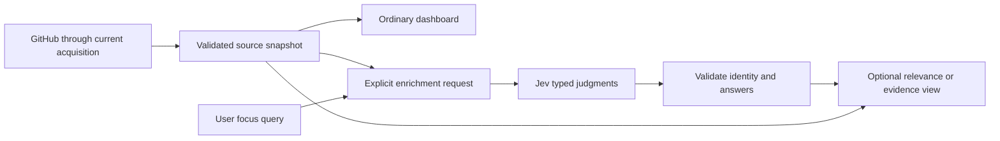

# Assessment: where Jev can improve gh-glance

Date: 2026-10-28. Repository: `/Users/juan/code/gh-glance`, `develop`, baseline `0319c9c58d211867ec35776357259b02b235909f`, package 0.17.1. This assessment answers the user's explicit request for improvements after the separately documented [$rpi-research findings](2026-10-28-jev-capabilities-and-current-architecture.md). It is not an implementation plan or a measured integration result.

## Recommendation

**Use Jev as an optional semantic aid. Start with a Focus view that helps a developer find relevant loaded issues and PRs. Consider on-demand CI failure triage next. Keep acquisition, quota admission, freshness, authentication, CI routing and authoritative status deterministic.**

The promising gain is shorter developer time to find and understand relevant work. There is no evidence that Jev would reduce the current application's CPU use, memory use, GitHub requests or first-paint time. It adds an external request and processing. Its batching advantages apply to an AI workload we would introduce, not to gh-glance's existing local checks. This distinction matters because caching, request sharing, quiet polling and render suppression already exist (`index.mjs:1631`, `index.mjs:14470`, `index.mjs:15294`, `index.mjs:16637`, `index.mjs:20199`).

**Status:** capability fit supported by documentation and source inspection; developer benefit and runtime impact **UNMEASURED**; account-specific limits/retention **UNAVAILABLE** in this session. No live inference, product edit, dependency installation or remote mutation occurred.

## Evaluation criteria

The order below prioritizes useful developer outcomes with the data already available, bounded new acquisition, predictable terminal behavior, honest uncertainty, manageable maintenance, and an optional external-service dependency. It is an engineering judgment, not a benchmark-derived ranking. Current package constraints are Node ESM, one executable, no build step and two runtime dependencies (`package.json:5`, `package.json:9`, `package.json:55`; `CONTRIBUTING.md:307`).

| Opportunity | Developer benefit | Additional evidence needed | Assessment |
| --- | --- | --- | --- |
| Semantic Focus/search | Find related issues or PRs when vocabulary differs | Existing loaded titles/label/branch plus user query | Best first experiment; bounded utility and data |
| CI failure lens | Identify the useful failed step and classify visible evidence | Jobs, attempts, exact commit and bounded log excerpts | Strong second candidate; greater acquisition/privacy work |
| Personal attention queue | Surface work that actually needs this developer | Review requests, assignees, checks, relationships and relevant text | Valuable later; exact metadata must come first |
| Related-failure or duplicate suggestions | Reduce repeated investigation | Candidate pairs and sufficient comparable text | Later, as reversible suggestions with evidence |
| Security context annotations | Add context to existing alerts | Dependency/source/exploitability context | Defer; current rows are insufficient |
| Natural-language command routing | Translate language into allowed read-only operations | New text-input interaction and command schema | Low priority beside the existing short key map |
| AI polling/governor/auth decisions | No demonstrated advantage over exact code | Would add probabilistic input to control rules | Do not pursue |
| Generative explanations, autonomous fixes, merges | Outside Jev's documented output and current task | Other models/tools and new authority | Not a Jev-only feature |

Existing inputs: `index.mjs:1070`, `index.mjs:1085`, `index.mjs:1467`, `index.mjs:2195`. Existing keyboard operations: `index.mjs:11725`. Jev supports narrow typed judgments, not generated fixes or autonomous tool execution. [Coding-agent guide](https://docs.typesafe.ai/introduction/coding-agents.md), [building with TypeSafe](https://docs.typesafe.ai/concepts/how-to-build-with-system-one.md).

## A1. First experiment: semantic Focus over loaded rows

Example interaction: a developer enters “authentication regressions” or “changes related to caching” and receives relevant loaded issues/PRs, retaining their original identity, title, URL and source age. The ordinary list remains immediately available. This adds a capability the current keyboard and viewport paths do not provide (`index.mjs:17963`, `index.mjs:20291`).

The semantic job is narrow: judge whether a title and available metadata concern the requested topic. Use independent relevance questions for multi-result search; a Choice can identify the strongest candidate but its probabilities compete and are not absolute relevance scores. Where a Choice is used, add an independent no-match check. Do exact number/author/branch/date filters locally. The relevant examples are [shortlist reranking](https://docs.typesafe.ai/cookbooks/rerank_typesafe.md) and [semantic evidence selection](https://docs.typesafe.ai/cookbooks/semantic_find.md).

The first version can use current rows without fetching bodies or files. That makes the acquisition cost bounded and the evidence limit explicit: **matches among loaded title/metadata**, not repository-wide search, issue understanding or proof that nothing relevant exists. Current lists are capped and title fields are sanitized/truncated (`index.mjs:119`, `index.mjs:305`, `index.mjs:1941`). Missing context must remain visible. Loading more pages or bodies would be a separate product/acquisition decision.

For these bounded lists, start evaluation by scoring all eligible loaded rows within the context limit. Compare an optional keyword/BM25 shortlist for larger inputs; shortlisting can save tokens but can also remove the synonym match this feature is meant to find. Avoid claiming a retrieval improvement over an unrealistically weak baseline.

Compare against a simple local text/fuzzy search using the same items and queries. Jev earns its dependency only if it materially improves relevant-result discovery on vocabulary-mismatch cases while the ordinary view remains responsive. A keyboard-driven TUI also has a real input-design cost; it needs an intentional search mode with clear exit/cancellation behavior, not a background prompt on every keypress.

## A2. Next candidate: a CI failure lens with selected evidence

For a selected failed run, show a fixed category such as test assertion, dependency installation, permissions, runner/network or insufficient evidence, together with the original failed step and selected log lines. Jev can classify the supplied text and select evidence IDs; code can produce the display from templates. This is evidence navigation, not a generated root-cause explanation. [Candidate extraction](https://docs.typesafe.ai/cookbooks/pre_parsed_value_extraction_cookbook.md), [evidence checking](https://docs.typesafe.ai/cookbooks/classifying_rag_passages.md).

This needs new acquisition. The current Actions projection has no logs, job steps, source SHA or run attempt (`index.mjs:1467`). A credible lens needs all four, plus repository/run/job identity and a clear indication when logs are unavailable, incomplete or stale. New GitHub operations need declared costs, normal admission and bounded data collection (`index.mjs:2278`, `index.mjs:749`). Inspecting a selected run is a better initial trigger than automatically downloading every failed log.

Use multiple narrow observations where several causes may coexist: “Does the excerpt contain an assertion mismatch?”, “Does it report package-download failure?”, “Does it explicitly report denied permission?” Code combines those with exact failed-step/conclusion metadata. A test that fails once is not proof of flakiness; a failed download is not proof of a particular provider outage. Evidence outside the excerpt cannot be inferred.

Keep the source run's failure visible regardless of Jev output. Offer links to the exact run/job and original excerpts. No model answer should rerun a workflow, change a workflow, change CI cadence, or report a run as passed. Sutura owns routing under the supplied owner instruction and `/Users/juan/code/AGENTS.md:3`; this proposal is a read-only developer diagnostic surface.

If this is the user's dominant daily pain, it could take priority over Focus despite the larger scope. That would be a product-priority choice, not a change to the capability evidence.

## A3. Better attention decisions: facts first, semantics second

A useful attention queue can combine exact conditions such as review requested from this user, assigned issue, draft state, age and failed required checks with semantic dimensions such as reported regression or user-visible impact. Exact conditions must come from GitHub; Jev should not guess them from a title. Current PR/issue projections lack much of that metadata (`index.mjs:1070`, `index.mjs:1085`).

Jev's [composite-scoring pattern](https://docs.typesafe.ai/patterns/composite-scoring.md) supports keeping semantic dimensions separate so users can change weights without another call. However, a title-only “urgency score” would overstate the evidence. Start with a deterministic queue once the facts exist; compare whether semantics improves it. Current Security severity and source uncertainty remain authoritative (`index.mjs:7020`, `index.mjs:20237`).

The current Actions marker is based on the newest fetched run, not an exact SHA/workflow rollup (`index.mjs:20247`). If a feature needs exact-candidate CI status, model assistance does not supply that identity or completeness: acquire and aggregate it deterministically. Jev may annotate failure text afterward.

## A4. Other capabilities and why they come later

Related-failure groups and suggested issue duplicates are plausible applications of [entity alignment](https://docs.typesafe.ai/cookbooks/entity_alignment.md). Generate candidates using exact repository/workflow/error-family facts or lexical retrieval, then compare bounded pairs. Preserve every original item and allow disagreement; similar text does not establish shared cause. Comparing all pairs across a portfolio would add unnecessary quadratic work. This project is currently a repository-targeted dashboard, so portfolio grouping would be a larger scope change (`index.mjs:1274`, `index.mjs:13317`).

Security annotations may eventually explain which supplied component context an alert concerns. Present projections do not establish reachability or exploitability (`index.mjs:2195`). Jev must not lower GitHub severity, hide critical alerts, dismiss them or infer a clean repository from missing data. This limitation comes from the specific feature's evidence, not from a generic objection to AI.

Natural-language navigation is supported by Jev's [function-calling recipe](https://docs.typesafe.ai/cookbooks/function_calling.md), but four direct tab keys and a few actions already cover the current UI (`index.mjs:11725`). Semantic search adds a clearer capability than using a network model to interpret “open PRs.” Image/Box features have little fit for this terminal product and remain experimental. [Images](https://docs.typesafe.ai/images.md), [Box](https://docs.typesafe.ai/primitives/box.md).

The memory and feature-discovery recipes are application examples, not built-in persistent memory or automatic learning. They add state/labels and other components; there is no demonstrated need for them in the initial feature. [Memory example](https://docs.typesafe.ai/cookbooks/basic_memory.md), [feature discovery](https://docs.typesafe.ai/cookbooks/autoresearch_feature_discovery.md).

## Proposed integration boundary

The following is an assessment of a compatible direction, not an approved design contract:

The model path should never delay ordinary snapshot publication or hold a governor/file lock. Tag results with the source identity/content digest, access partition, requested feature/query, question version and resolved model. Late answers for changed data/accounts must be rejected. Cache equivalent work and share it only inside an appropriate access partition; do not infer permission from shared quota identity (`index.mjs:13807`, `index.mjs:14770`). Semantic annotations need their own time/status and must never advance GitHub source freshness.

| Condition | Proposed behavior |
| --- | --- |
| Disabled, no key or no permitted data | Ordinary dashboard; no model request |
| Fresh matching result | Display annotation/ranking with source coverage |
| No semantic match | Report no match among evaluated items; retain ordinary view |
| Ambiguous answer | Show uncertainty or ordinary order, with source items available |
| API error, timeout, malformed answer or missing question | Enrichment unavailable; never reinterpret as “no problem” |
| Source/account changes during the request | Discard late answer; keep current source data |
| Service limit or spend cap reached | Pause enrichment with a visible reason; normal collection continues |

Confidence is distribution concentration, not permission to act or an accuracy guarantee. Starting thresholds from examples require domain evaluation; a highly concentrated wrong answer remains wrong. Preserve the independent no-match/uncertain outcome. [Confidence](https://docs.typesafe.ai/confidence.md), [Noul](https://docs.typesafe.ai/primitives/noul.md).

Standalone use could keep a user-supplied TypeSafe key in the local process; never distribute a maintainer key in the package or pass it to GitHub/SSH children. Collector deployment can centralize enrichment later, but current snapshots have exact row/field schemas and do not carry arbitrary extra annotations (`index.mjs:8848`, `index.mjs:8884`). Client-side enrichment of already received rows avoids that protocol change initially, at the cost of possible duplicate model work across clients. This trade-off should be chosen for the first supported topology, not solved by adding a general service prematurely.

The SDK fits Node ESM without a TypeScript build. A narrow direct HTTP adapter is also possible, but makes validation/error behavior ours. Prefer evaluating the official SDK for a feature with multiple question types; compare package/startup overhead before selecting it. Configure a whole-operation deadline/cancellation and bounded retries explicitly: SDK defaults are unsuitable as an implicit terminal responsiveness contract. Avoid unredacted debug-body logging. [SDK](https://docs.typesafe.ai/sdk/javascript.md), [request options](https://docs.typesafe.ai/sdk/javascript/api/interfaces/RequestOptions.md), [client configuration](https://docs.typesafe.ai/sdk/javascript/api/interfaces/TypeSafeClientConfig.md), [retry policy](https://docs.typesafe.ai/sdk/javascript/api/interfaces/RetryPolicy.md).

Repository text is untrusted model input. Fixed question schemas and validation must keep it from introducing commands, URLs or authorization. The model is not the security boundary; existing sanitization still applies, and `safe()` is not secret removal (`index.mjs:307`). Public versus private repository content requires an explicit product data policy; logs especially can contain secrets. TypeSafe's no-training statement is distinct from retention, and enterprise ZDR was not verified for this account. [Legal](https://docs.typesafe.ai/legal.md), [DPA](https://typesafe.ai/legal/data-processing).

## Performance and cost judgment

| Dimension | Supported conclusion |
| --- | --- |
| Time to find relevant work | Plausible improvement; must compare against local search/rules |
| GitHub requests | Focus can reuse loaded rows; log/body features add collection |
| Startup and first paint | Can remain independent of inference; no measured equality yet |
| CPU, memory and network | Additional work; cache/batch/bounds can limit overhead |
| Refresh/freshness | Existing deterministic machinery remains responsible |
| AI processing cost | Shared-state batching and caching can reduce introduced inference |
| Reliability | Ordinary view can survive provider failure; annotations remain probabilistic |

Do not poll Jev on the dashboard timer. Trigger enrichment from an explicit query or relevant changed content, keep one in-flight equivalent request, batch related questions, and reuse unchanged results. This applies TypeSafe's [fan-out](https://docs.typesafe.ai/patterns/fan-out.md) and [parallel-question](https://docs.typesafe.ai/cookbooks/parallel_questions.md) patterns without importing their example speedup as a product claim.

Illustrative input-token arithmetic, not a quote for this account: at the documented $0.042/M input tokens, a request totaling 5,000 input tokens costs $0.00021; 1,000 such requests cost $0.21. Total input includes state and question text. Extra GitHub acquisition, retries, network and operational work remain separate. [Models/pricing](https://docs.typesafe.ai/models.md). Missing SDK usage is unknown, not zero spend. [Usage contract](https://docs.typesafe.ai/sdk/javascript/api/interfaces/Usage.md).

## Evidence that should decide whether to proceed

Before a production feature, compare the same fixed public/synthetic developer examples under deterministic rules/local search and a pinned Jev version. Use held-out cases, vocabulary mismatches, multilingual text, empty/no-match queries, ambiguous titles, truncated content and adversarial instructions. Measure useful top-result recall/precision and user task completion time; for failure classification, measure category precision and selected-evidence correctness separately from model confidence. An uncertainty path is part of success, not a test failure to tune away.

Measure end-to-end p50/p95/p99 latency, keypress responsiveness, first paint, process-tree CPU/RSS, network attempts, actual token usage, duplicate suppression and stale-answer rejection. The repository already exposes acquisition counters and an independent efficiency oracle (`index.mjs:11136`, `test/efficiency.test.mjs:120`), but its current CPU/RSS measurement covers only the parent process (`scripts/measure-efficiency.mjs:1666`). No new percentage speedup can be inferred from those existing contracts.

Decisive acceptance properties include no model traffic while disabled, no additional GitHub requests for loaded-row Focus, no inference dependency on first paint, no cross-account results, no stale result replacing newer source data, and usable ordinary views during provider failure. Run the existing applicable sequential gates if implementation is approved; rendering needs PTY verification, and acquisition changes need the efficiency gate (`package.json:17`, `package.json:21`, `package.json:27`, `package.json:29`).

The recommendation reverses if lexical/deterministic alternatives perform similarly, title-only evidence is insufficient, p95 interaction cost outweighs time saved, external data processing is unacceptable, or users do not use the feature. Then retain the simpler local feature. If selected-run diagnostics save substantially more developer time, prioritize A2 instead of A1.

## Handoff and remaining decisions

A1 is the recommended evaluation target; A2 is a supported later candidate; A3/A4 require richer evidence or larger scope. Runtime control replacement, authoritative security judgment and autonomous CI actions are rejected for this goal. These are assessment dispositions, not changes made to the application.

The local deliverables are this assessment and the companion factual research, against the baseline above. All three investigator results were received and reviewed. No live benchmark, product tests, account inspection, paid experiment, push or publication was performed. Browser access failure leaves organization limits and retention unverified. The documentation snapshot has minor version/provenance inconsistencies, recorded in the research; pin and recheck selected contracts before experimentation.

The next decision is whether to evaluate Focus or selected-run diagnostics, and which content may be sent under what experiment budget. A later live probe needs that concrete data/spend scope; it is not required to complete this assessment. Planning and implementation remain separate workflows. On resume, revalidate the repository commit, worktree, model/API versions and current source projections; historical artifacts do not grant new authority.
